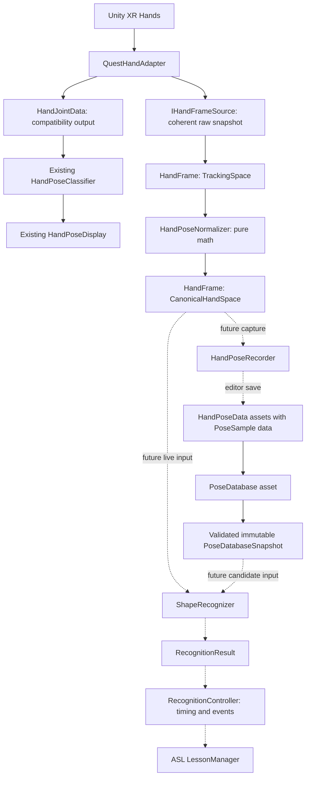

# Hand pose scalability: implementation handoff

Prepared 2026-10-11 from the current repository and the supplied whiteboard diagram.

## Current status and next assignment (updated 2026-10-11)

The software data foundation below has been implemented. See [HAND_POSE_FOUNDATION_SETUP.md](HAND_POSE_FOUNDATION_SETUP.md) for the actual APIs, saved synthetic assets, 294 passing Unity tests, measured allocation events and remaining Quest Link checks.

The active **next implementation assignment** is [HAND_POSE_RECOGNITION_HANDOFF.md](HAND_POSE_RECOGNITION_HANDOFF.md): complete conversation step 2 (ShapeRecognizer/RecognitionResult), then step 3 (bounded real-sample recorder, editor review/save, controller timing and opt-in display integration). Those step numbers refer to the user's next-work list, not phases 2 and 3 of the completed foundation table below. This update specifies future work; it does not claim that the matcher, recorder or controller is implemented, or that the headset regression check has passed.

The remainder of this file is the original foundation specification and remains the reference for frozen data contracts and compatibility protections. Its foundation-only exclusions do not prohibit the next assignment explicitly authorized by the new handoff.

## Assignment

Implement `HandFrame`, `HandPoseData`, and `PoseDatabase`, with the small supporting capture and normalization contracts needed to make them usable by a later `ShapeRecognizer`. Keep the current demo working while adding a parallel template-data pipeline. This milestone prepares scalable static handshape recognition; it does not implement the matcher or claim to solve every ASL sign.

Read `CLAUDE.md` and any applicable `AGENTS.md` first. This handoff is the specification for the new data-foundation milestone. Its scope supersedes the historical exclusions of frames, normalization, ScriptableObjects, and databases in `CLAUDE.md` for this milestone only. Preserve the existing compatibility constraints. Do not treat stale version status in that file as evidence that the current code is unimplemented. Report progress after each phase; do not invent an additional approval requirement from the older thumbs-up workflow.

## Verified starting point

Paths in this document are relative to `codeRedUnity/` unless stated otherwise.

| Existing file | Current responsibility and consequence |
| --- | --- |
| `Assets/Scripts/HandPose/QuestHandAdapter.cs` | A `MonoBehaviour` reads one selected XR hand on `updatedHands`, only for `UpdateType.Dynamic`. Exposes `currentHand`, `handedness`, and `trackingState`; clears data on disable/subsystem loss. It reads 24 digit joints, without wrist/palm or joint rotations. |
| `Assets/Scripts/HandPose/HandJointData.cs` | Value structs hold thumb/finger positions and aggregate validity per digit. Positions remain in tracking space. `trackingSpaceToWorld` and `hasTrackingSpaceToWorld` carry the Camera Offset's world rotation separately. |
| `Assets/Scripts/HandPose/HandPose.cs` | **Already an enum**, with `Unknown = 0`, `Open = 1`, `Fist = 2`, `Pointing = 3`, `V = 4`, `U = 5`, `Y = 6`, `L = 7`, `ThumbsUp = 8`. Do not replace it with a template class or renumber it. |
| `Assets/Scripts/HandPose/HandPoseClassifier.cs` | Existing pure C# finger, thumb, spread, pose, and world-up orientation rules. Keep this backend intact. |
| `Assets/Scripts/HandPose/HandPoseDisplay.cs` | Currently orchestrates the adapter and legacy classifier as well as displaying/debugging results. Later recognition orchestration can move into a controller; this milestone does not need that UI refactor. |
| `Assets/Scripts/HandPose/HandJointVisualizer.cs` | Draws all five digits using tracking-space positions under Camera Offset. Keep its behavior. |
| `Assets/Tests/EditMode/` | Existing synthetic classifier, integration, display, and visualizer tests; `FakeHandData.cs` builds the old structs. Add separate frame fixtures without rewriting old test methods. |
| `Assets/Scripts/HandPose/HandPose.Runtime.asmdef` | Runtime assembly, namespace `HandPoseRecognition`. Use the current assembly initially. |
| `Assets/Scripts/HandPose/Editor/HandPose.Editor.asmdef` | Existing boundary for editor-only tooling. |

Local versions: Unity **6000.0.34f1**, XR Hands **1.5.1**, OpenXR **1.14.0**, Test Framework **1.4.5**. These were read from `ProjectSettings/ProjectVersion.txt` and `Packages/manifest.json`.

Saved values in `Assets/Scenes/HandPoseDemo.unity` differ from some script defaults:

| Setting | Saved scene value |
| --- | --- |
| `extendedMaxCurlDegrees` / `curledMinCurlDegrees` | `70` / `160` |
| `thumbExtendedMinTipDistanceRatio` / `thumbCurledMaxTipDistanceRatio` | `0.75` / `0.45` |
| `spreadTogetherMaxRatio` / `spreadApartMinRatio` | `0.10` / `0.25` |
| `thumbUpMaxAngleDegrees` | `35` |

The demo selects the right hand and assigns Camera Offset as the tracking-space transform. Preserve these saved values, all script defaults, existing serialized field names, scene references, and `.meta` GUIDs. Do not regenerate the demo scene to add this foundation.

The following installed sources were inspected and should be rechecked before extending capture:

- `Library/PackageCache/com.unity.xr.hands/Runtime/Enums.cs`: joint IDs, handedness, and `ToIndex()`.
- `Library/PackageCache/com.unity.xr.hands/Runtime/XRHandJoint.cs`: `TryGetPose(out Pose)` and tracking validity.
- `Library/PackageCache/com.unity.xr.hands/Runtime/XRHand.cs`: `GetJoint`, `isTracked`, and the warning that copying an `XRHand` does not copy its mutable native joint storage.
- `Library/PackageCache/com.unity.xr.hands/Runtime/XRHandSubsystem.cs`: callback update types and success flags.

PackageCache is local, generated, and may move after package restoration. It is evidence for API usage, not a location to edit. No implementation or test run was performed in preparing this handoff.

## Adjusted architecture



Solid paths are the foundation/current system; dotted paths are future integration. Synthetic samples and a minimal editor authoring path must allow the database to be exercised before the recorder exists.

Tweaks to the whiteboard:

1. Use **`HandPoseData`** for template definitions because `HandPose` already names the legacy enum. New templates use stable string IDs rather than requiring enum edits.
2. Use **`IHandFrameSource`** instead of reading joints individually through `IHand`. One snapshot is one provider update; consumers cannot accidentally assemble a hand from different updates. No redundant `IHand` interface is needed now.
3. Distinguish raw tracking-space frames from canonical frames explicitly. Normalize live and recorded data with the same versioned algorithm, exactly once.
4. Give `JointPose` explicit joint identity and separate position/rotation validity. A single `IsValid` boolean cannot describe missing rotation with a usable position.
5. Treat the database as a Unity asset catalog backed by a validated runtime snapshot, not a database server or scene-search service. Recognition reads pure data, with no asset edits or Inspector access in the match loop.
6. Keep world orientation separate from rotation-invariant shape. Canonical shape alone cannot preserve the existing world-up thumbs-up rule or resolve orientation-dependent ASL pairs.
7. A future recorder collects bounded snapshots and produces samples. It does not classify poses, and the normalizer does not read hardware. A future controller handles dwell/cooldown and lesson events; the matcher remains stateless.

## Data contracts to implement

### Stable joint layout and handedness

Add project-owned `HandJointId`, `HandSide`, and `HandFrameSpace` enums, with explicit numeric values and safe invalid/default members where appropriate. `HandSide` is `Unknown = 0`, `Left = 1`, `Right = 2`. Keep XR package enums at the adapter boundary.

Joint layout version 1 has exactly **26 slots**:

| Slot(s) | Joint(s), in order |
| --- | --- |
| 0 | Wrist |
| 1 | Palm |
| 2-5 | ThumbMetacarpal, ThumbProximal, ThumbDistal, ThumbTip |
| 6-10 | IndexMetacarpal, IndexProximal, IndexIntermediate, IndexDistal, IndexTip |
| 11-15 | MiddleMetacarpal, MiddleProximal, MiddleIntermediate, MiddleDistal, MiddleTip |
| 16-20 | RingMetacarpal, RingProximal, RingIntermediate, RingDistal, RingTip |
| 21-25 | LittleMetacarpal, LittleProximal, LittleIntermediate, LittleDistal, LittleTip |

Use a distinct invalid enum value outside the slot range (for example `Invalid = -1`) and initialize absent slots with their correct ID and false validity flags. Never infer availability from a default enum or a zero position. A wrist legitimately at the origin is valid.

No `ThumbIntermediate`; no XR begin/end markers in data. Explicitly map provider IDs to project IDs. XR IDs are not safe to cast directly to array indexes; the installed package's `ToIndex()` handles its offset. Freeze project slot ordering and bump the layout version for incompatible changes.

### `JointPose` and `HandFrame`

`JointPose` is a value type with `JointId`, `Vector3 Position`, `Quaternion Rotation`, `HasPosition`, and `HasRotation`. If helpful, expose `IsValid` as the computed full-pose condition `HasPosition && HasRotation`; position-based recognition must use `HasPosition` instead.

`HandFrame` is a plain C# owned snapshot, preferably a sealed class with read-only accessors:

| Member | Contract |
| --- | --- |
| `TimestampSeconds : double` | Finite, nonnegative, monotonic session time sampled at acquisition. Document the chosen Unity monotonic clock; this is not wall-clock time or a promised hardware sample timestamp. |
| `SequenceId : ulong` | Advances for each Dynamic update/status invalidation from this source, including loss updates. Re-reading the same frame does not advance it. Sequence scope is one source lifetime. |
| `HandSide` | Explicit side; Unknown is unusable for matching. |
| `IsTracked` | Provider reports tracking for this update. Distinct from joint availability. |
| `Space` | `Unknown`, `TrackingSpace`, or `CanonicalHandSpace`; default Unknown is unusable. Raw positions are meters; canonical positions are unitless. |
| `JointLayoutVersion` | Version 1 for the table above. |
| `NormalizationVersion` | `0` for raw; `1` for canonical algorithm below. |
| Joint access | Exactly 26 slots. `TryGetJoint(HandJointId, out JointPose)` returns false for invalid/missing position, and returns rotation availability separately on the joint value. No mutable backing-array exposure. |
| `TrackingSpaceToWorld` / availability | Preserve the existing rotation-only metadata on raw frames. No `Transform` reference in the snapshot. |
| `IsValid` | Computed: structurally valid layout/metadata, tracked, known side, and at least one finite valid position. This is a minimal usable-data check, **not** permission to record or recognize a template. Normalization and candidates require their own joints. |

Requirements:

- Copy joint values out of XR storage during the callback. Do not retain an `XRHand`, native array, component, or live collection.
- Make construction own the data: copy caller arrays, or transfer an internal array that the producer never reuses or exposes. Read-only wrappers alone do not stop a producer from mutating the backing array.
- Reject malformed counts, duplicate/misordered joint IDs, unsupported versions, invalid times, and nonfinite metadata with an explicit construction/validation failure. Missing tracking or individual joints are ordinary status snapshots, not exceptions.
- A successful provider pose read still needs numerical validation. Nonfinite position clears position validity; finite nonzero quaternions can be normalized, otherwise rotation is unavailable. Never substitute valid identity rotation for a failed read.
- Invalid joints carry finite placeholder values with validity false; never feed those placeholders into matching. An untracked frame exposes no valid joints.
- Retained raw frames, normalized frames, and samples remain unchanged when the next update arrives or the source is disabled.
- Copies and normalization preserve side, timestamp, and sequence. Canonical output records its normalization version and retains raw orientation metadata as explicitly tracking-space metadata, not as a canonical-to-world transform.

### `IHandFrameSource` and adapter integration

The minimal proposed surface is:

```csharp
public interface IHandFrameSource
{
    HandSide HandSide { get; }
    bool TryGetLatestFrame(out HandFrame frame);
}
```

The return value means a current snapshot is available, not that it is tracked or recognizable. Before the first update it may return false; after a loss update it returns an explicitly untracked frame. On disable/subsystem shutdown, invalidate availability or publish an untracked snapshot immediately. Never keep returning the last tracked frame. Consumers use sequence/time to avoid recording the same frame twice and to apply future freshness policy.

Have `QuestHandAdapter` implement this interface additively. Keep its serialized XR `m_Handedness` field and existing lowercase public properties untouched; map the new `HandSide` property explicitly to the project enum. Do not break scene serialization to replace the existing provider enum.

Capture wrist/palm and full joint poses inside the existing Dynamic callback. Use the selected hand's success flags and `isTracked`; recheck each joint read, and never publish failed updates as fresh valid geometry. Continue ignoring BeforeRender for this logical pipeline. Read each joint once for the new capture and project its positions into the legacy structs where practical, preserving each digit's aggregate validity and existing tracking-state semantics. Missing wrist/palm must not newly invalidate the legacy four-finger classifier.

The old `currentHand` and new frame must represent the same callback. Preserve `ApplyTrackingSpace` and the existing orientation conversion behavior. The adapter is the only runtime layer that touches XR Hands; the new data/math layers may use Unity value types, but not XR or scene APIs.

### `HandPoseNormalizer`: small shared prerequisite

Implement a pure `TryNormalizeFrame(raw, out normalized, out failureReason)` helper now so stored samples and the future live matcher have a concrete shared coordinate contract. It accepts TrackingSpace/version-1 frames only, rejects already-canonical input, and never mutates the input.

Canonical normalization version 1:

1. Require valid finite positions for Wrist, IndexProximal, MiddleProximal, and LittleProximal.
2. Origin `o = Wrist`. Scale `s = |IndexProximal - LittleProximal|` (palm width).
3. `x = normalize(IndexProximal - LittleProximal)`, pointing across the palm toward the index side.
4. `v = MiddleProximal - Wrist`; `y = normalize(v - dot(v, x) * x)`, pointing toward the fingers after removing the across-palm component.
5. `z = normalize(cross(x, y))`. This defines a right-handed orthonormal basis. Check its construction for finite results and degeneracy.
6. For each available position `p`, output `(dot(p-o,x), dot(p-o,y), dot(p-o,z)) / s`.
7. For available rotations, use the inverse basis rotation: `qCanonical = inverse(qBasis) * qTracking`, then validate/normalize. Do not apply scale to quaternions.

Use named, documented tolerances: initially reject palm width or projected forward length below `1e-4` meters, and a degenerate cross-product direction. Verify finite intermediates/outputs; pathological magnitudes must fail safely. Revisit tolerances from measured hand data without silently changing normalization version semantics.

Partial frames can normalize if anchors are usable; retain missing joints as unavailable. Sample creation applies stricter requirements below. No imputation, hidden fallback basis, per-joint rescaling, or dynamic alignment to a candidate template.

Do not mirror left hands into right hands in version 1. Keep separate side-specific templates. Translation, rotation, and positive uniform hand-size scaling preserve canonical **shape**; rotation relative to world up is intentionally removed. Preserve raw orientation information separately for a later orientation stage. Nonuniform/negative rig scale remains unsupported, as in the current orientation pipeline; do not change that policy here.

### `PoseSample` and `HandPoseData`

`HandPoseData` is a `ScriptableObject` template definition with a `CreateAssetMenu` entry. `PoseSample` is serializable plain data containing owned canonical joint values, not a scene object or live frame reference. Keep runtime `HandFrame` ownership separate from Unity's serialized arrays/lists.

| Field | Requirement |
| --- | --- |
| `SchemaVersion` | Start at 1. Unsupported versions produce explicit validation errors; never assume missing/old data is current. |
| `PoseId` | Stable, globally unique, case-sensitive string; use ordinal comparisons. Require nonblank IDs without leading/trailing whitespace. Example: `shape.open.right`. Changing DisplayName or asset filename does not change it. |
| `DisplayName` | Required nonblank user-facing text, independent of identity. |
| `HandSide` | Left or Right only. A separate asset/ID per side for version 1. |
| `JointLayoutVersion` / `NormalizationVersion` | Must match supported canonical versions. Each sample must agree with its template. |
| `Samples` | One or more owned canonical samples, all matching this side/layout/normalization. Sample provenance may include source timestamp/sequence for debugging; it never controls identity. |
| `JointWeights` | Exactly 26 finite nonnegative values keyed by the frozen slot order; at least one positive. New assets default to 1 for each joint. Zero means excluded. The initial matcher will use positions, not rotations. |
| `MaxError` | Finite, nonnegative inclusive match threshold, in unitless normalized palm-width distance. Expose for future tuning; no claim that a provisional value is calibrated. |

For version 1, all positive-weight joints are required in **every** sample and in a live candidate comparison. Missing zero-weight joints are allowed, but normalization anchors are always required during raw-to-canonical conversion. Do not silently drop joints from the denominator to obtain an artificially good score. Optional partial-coverage recognition is a future explicit policy/schema extension.

Samples must be created from successfully normalized frames through one validation/conversion path. Direct Inspector authoring is still validated; reject raw-space data, nonfinite values, invalid weighted positions, mismatched side/version, and malformed arrays. Invalid rotations may remain unavailable because this milestone prepares position matching. Ensure invalid rotation flags do not invalidate otherwise usable positional samples.

Provide a configurable maximum samples per pose (initial default 32) and reject over-limit input with a clear report; never silently truncate. This is a storage budget, not an empirically established recognition optimum. Avoid filling assets with every frame of a long recording. A later recorder will select representative samples across people/captures rather than assuming adjacent frames are independent evidence.

No implicit mapping to the legacy `HandPose` enum. Lessons will reference `PoseId`. Orientation-dependent labels must not be advertised as fully recognized by these shape-only templates.

### `PoseDatabase` and runtime snapshot

`PoseDatabase` is a `ScriptableObject` containing explicit references to `HandPoseData` assets and its own schema version. Its array/list is Unity authoring data; compile it once into an immutable plain C# `PoseDatabaseSnapshot` containing copied template/sample data, never mutable asset references.

Proposed operations (equivalent names are acceptable if documented):

```text
PoseDatabase.TryBuildSnapshot(out PoseDatabaseSnapshot snapshot, out ValidationReport report)
PoseDatabaseSnapshot.TryGetPose(string poseId, out PoseTemplate template)
PoseDatabaseSnapshot.GetCandidates(HandSide side) -> read-only cached collection
```

Build indexes with ordinal ID keys and candidate buckets by side. The database is a catalog, not the matcher: do not calculate distances, choose a winning pose, own recording state, or invoke lessons here.

Validate on explicit build/load, with optional editor `OnValidate` diagnostics. Runtime correctness must not rely on `OnValidate` being called. A build fails with actionable asset/pose/sample/joint paths for null references, duplicate IDs, unsupported versions, invalid sides, empty sample sets, invalid weights/thresholds, and invalid sample data. Return no usable snapshot on failure; never silently overwrite duplicate IDs or skip bad assets. A supported empty database is valid and has no candidates; the later matcher returns NoMatch.

Snapshot builds are atomic: expose a complete valid immutable snapshot or a failure. At startup, failure means recognition is unavailable. If a future reload fails, a caller may deliberately retain its prior valid snapshot, but must surface the failure rather than pretending the update succeeded. Asset edits require an explicit rebuild and cannot mutate a previously published snapshot.

Keep candidate iteration deterministic by ordinal PoseId and stable sample index. Do not depend on dictionary enumeration order. No `Resources.LoadAll`, `FindObjectsOfType`, asset discovery, LINQ materialization, validation, or index rebuild per recognition update.

## Boundary for the later ShapeRecognizer

Document this contract and leave matcher/controller implementation for the next milestone. The supplied weighted-distance equation becomes well-defined only after both inputs use the same canonical layout and normalization version.

For a live canonical frame `Q` and recorded sample `P`:

```text
I = all joints with template weight w_i > 0
Require every joint in I to have a valid finite position in P and Q.
E(P,Q) = sum(i in I, w_i * EuclideanDistance(P_i,Q_i)) / sum(i in I, w_i)
E_pose(Q) = minimum eligible sample error for that pose
```

- Use Euclidean distance, not squared distance, so thresholds retain the stated units. Guard finite terms, accumulation, and positive denominator.
- Filter by side/layout/normalization before comparison. Normalize the live frame once per acquisition, not once per candidate. Templates are normalized during authoring, not during the match loop.
- Reject an untracked, stale, unsupported, or noncanonical live frame. The future controller supplies a configurable freshness bound; timestamp availability is provided here, without choosing a hardware-dependent timeout now.
- Missing required joints makes that candidate ineligible, never a zero error. Empty candidate sets or no eligible comparisons return NoMatch with an explicit reason and no valid score.
- Choose the lowest-error eligible pose deterministically; exact ties use ordinal PoseId and sample index. A match requires `E_pose <= MaxError`. Later introduce a calibrated runner-up margin if ambiguity warrants it; do not call the error a probability/confidence.
- A future `RecognitionResult` should contain `PoseId`, `Error`, `HasScore`, `IsMatch`, side, frame timestamp/sequence, and a status/reason. Separate tracking/normalization failure from a valid observation with no matching pose. No-match must not default to `Error = 0` with a valid score.
- Stateless linear matching costs `O(S * J)` across eligible samples, with `J = 26`; ID lookup is indexed. Side and later lesson candidate filters reduce `S`. Add feature indexing or another backend only after corpus size and profiling justify it. A catalog does not by itself guarantee unlimited recognition scale or accuracy.

The future `RecognitionController` owns backend selection, rate limiting, dwell/hysteresis, cooldown, and event emission. It can initially use either the old classifier or the template recognizer; do not silently merge their results or alter pose priority now. `ASL LessonManager` subscribes to controller results and validates lesson targets by PoseId; it never reads hardware or template arrays directly.

## Files and implementation order

Keep new runtime files under `Assets/Scripts/HandPose/` with namespace `HandPoseRecognition`, using small `Data/` and `Recognition/` subfolders if helpful. Do not split assemblies or add packages just to implement this milestone. Keep all `UnityEditor`/`AssetDatabase` calls under the existing Editor assembly. Check in Unity-generated `.meta` files for all new Assets files/folders.

| Phase | Proposed files | Deliverable |
| --- | --- | --- |
| 1: snapshot contracts | `HandSide.cs`, `HandJointId.cs`, `HandFrameSpace.cs`, `JointPose.cs`, `HandFrame.cs`, `IHandFrameSource.cs` | Frozen layout, owned snapshots, numerical/structural validation; additive frame fixtures and tests. |
| 2: acquisition bridge | Additive changes to `QuestHandAdapter.cs`; optionally `HandFrameLegacyProjection.cs` | Full 26-joint coherent capture with per-joint validity, source metadata, and preserved legacy output. |
| 3: canonical samples | `HandPoseNormalizer.cs`, `PoseSample.cs`, `HandPoseData.cs` | Versioned canonical conversion, validated serializable templates, independent sample ownership. |
| 4: catalog | `PoseDatabase.cs`, `PoseDatabaseSnapshot.cs`, `PoseTemplate.cs`, `PoseDataValidation.cs` | Clear validation report, atomic immutable build, ID/side indexes and deterministic iteration. Avoid duplicate validator logic across these types. |
| 5: authoring and verification | Minimal `Editor/PoseDatabaseAuthoring.cs` if Inspector alone cannot safely create canonical samples; new tests and setup docs | Create/save/reload a synthetic template/database and explain how to prepare real samples later. No full recording UI. |

Work through dependencies sequentially and explain each file's role. Keep scope to the new data path and compatibility integration. Do not add a placeholder ShapeRecognizer that returns invented matches just to complete a demo.

Minimal editor setup to document and verify:

1. Existing `Hand Pose Recognition` GameObject continues using its current QuestHandAdapter, HandPoseDisplay, and HandJointVisualizer references.
2. Use CreateAssetMenu entries such as `Hand Pose/Template` and `Hand Pose/Database`; create assets under `Assets/HandPoses/` in a test/demo subfolder with matching `.meta` files.
3. Populate one canonical synthetic sample through the shared normalizer/sample conversion path; label fixtures clearly as synthetic. Do not suggest these are validated ASL training templates.
4. Assign template assets to the database and explicitly build/validate its snapshot using the authoring tool or test harness. Describe errors, counts, versions, and candidate side; no recognizer component needs attaching yet.
5. Save/reload assets and confirm samples survive serialization. Future HandPoseRecorder wiring is documented as a follow-up, not an existing setup step.

## Required verification

Add new EditMode tests to the existing test assembly. Existing tests stay unedited; additive helper methods are allowed. Run the baseline first and report failures accurately rather than attributing them to this milestone without evidence.

| Area | Meaningful tests |
| --- | --- |
| Layout and defaults | All 26 mappings, no thumb intermediate/markers; invalid IDs; wrong count/order/versions; default/unknown data cannot appear usable. |
| Ownership | Mutate constructor input after frame creation; publish another provider frame; normalize a frame; edit source samples/assets after snapshot build. Retained frames/samples/database snapshots must not change. |
| Availability and numbers | Missing one joint vs whole digit; valid origin position; unavailable rotation with usable position; NaN/infinity; zero/nonfinite quaternion; failed pose read; untracked frame; bad timestamps. |
| Source lifecycle | Dynamic vs BeforeRender; sequence advances once per logical update; repeated reads reuse the same snapshot; disable, shutdown, loss, failed selected-hand update, and recovery cannot expose stale tracked frames. |
| Compatibility | New and legacy positions come from the same update; missing wrist/palm does not change old recognition; preserve aggregate digit flags, current properties, tracking hints, visualization, and orientation conversion exactly once. |
| Normalization | Known expected canonical coordinates; translation/rotation/positive uniform scale invariance within documented tolerance; unchanged source; unavailable non-anchor joint retained; bad/missing anchors, coincident palm-width joints, collinear basis, overflow, raw/canonical version misuse; rotations converted once. |
| Templates | Multiple samples; independent display name/ID; wrong side/version/space; missing required vs zero-weight joint; invalid weights/all-zero weights; negative/nonfinite MaxError; empty/over-limit samples. |
| Database | Empty valid database; valid multi-pose/multi-side catalog; exact duplicate IDs fail; ordinal case sensitivity; null asset; invalid child sample; deterministic candidate order; correct ID lookup/side buckets; explicit rebuild and old-snapshot immutability. |
| Unity persistence | Create/save/reload temp assets and validate a rebuilt snapshot. Delete only test-owned temp assets in cleanup; do not modify real authoring assets. Test CreateAssetMenu/editor integration where useful. |

Run Unity EditMode through the Unity Test Runner or a suitable batchmode command. Report actual result counts, test XML location, Unity version, and Console errors separately from any C# compilation check. Review the full diff, including new files, to ensure protected classifier bodies (`Classify`, `Tally`, `FingerCurlDegrees`, `ClassifyThumb`, `ThumbTipDistanceRatio`), existing tests, enum values, tuned settings, and unrelated XR samples remain unchanged.

Profile acquisition/normalization in Play Mode after warm-up, with a fixed hand count. Record allocations per Dynamic update and explain their ownership. An immutable 26-joint snapshot may allocate per update; do not claim allocation-free behavior without measurement. Reuse adapter scratch storage and avoid duplicate snapshots on repeated reads. Database validation/indexing happens at load/rebuild only. If measured snapshot allocation is unacceptable, introduce a documented caller-owned buffer with explicit copy-on-retention as a separate optimization; never pool/reuse arrays that retained immutable snapshots still own.

On Quest Link, verify all five digits/old poses still work, loss shows Unknown, raw frames report the selected side and per-joint availability, and nonidentity Camera Offset/XR Origin rotation still converts the thumb direction exactly once. Verify raw joints are not transformed to world coordinates. Headset tests and tuned recognition accuracy are separate from synthetic EditMode evidence; document any unperformed headset checks explicitly.

## Completion and next handoff

This milestone is complete when the source publishes coherent owned HandFrames; canonical samples use the shared versioned normalizer; templates and databases save/reload; runtime catalog builds validate and index immutable data; regression and new tests pass; and setup/remaining headset checks are recorded.

The implementing agent's final report must include changed files, public API decisions, test evidence, actual allocation observations, Unity authoring steps, and remaining hardware verification. It should give the next agent one concrete path: read a current raw frame, normalize it once, obtain same-side templates from the database snapshot, and implement the weighted-distance ShapeRecognizer against the contract above.

Deferred work: a bounded HandPoseRecorder and sample-selection UX, actual ShapeRecognizer/RecognitionResult implementation, orientation-aware recognition, controller timing/events, lessons, motion signs, two-hand synchronization, cloud storage, ML, and corpus-dependent feature indexing. These layers can then be added without changing the frozen joint/sample contracts or rewriting hardware capture.
